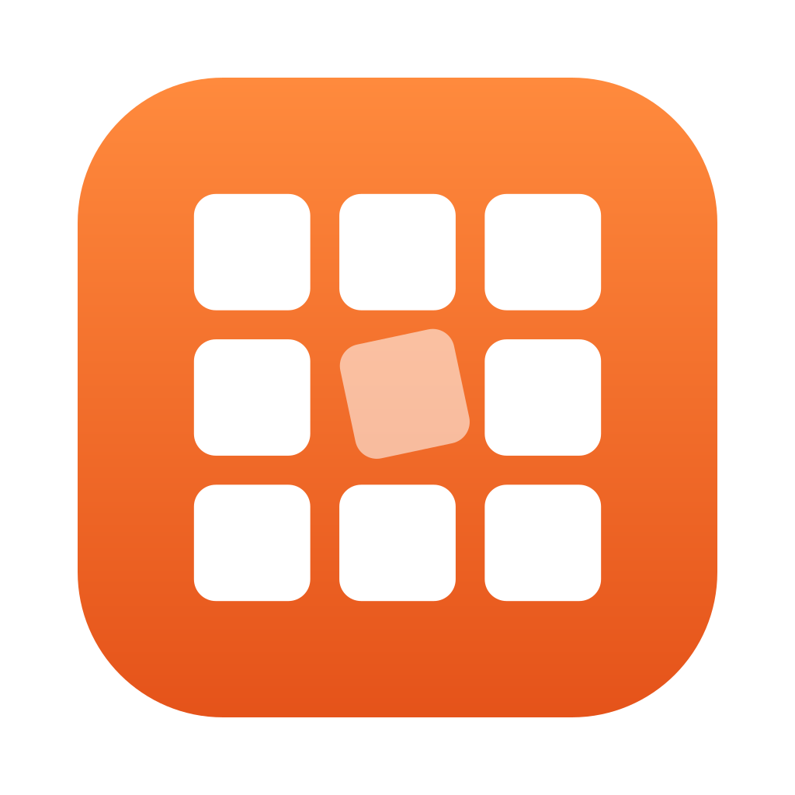

<p align="center">
  
</p>

<h1 align="center">GridGrip</h1>

<p align="center">
  Grab windows with the mouse. Snap them to a 3×3 grid with the keyboard.<br>
  A tiny menu bar app for macOS.
</p>

---

## Features

- **Move and resize with the mouse** – hold <kbd>fn</kbd>+<kbd>⌃</kbd> and move the mouse to drag the window under the cursor, or <kbd>fn</kbd>+<kbd>⌥</kbd> to resize it. No clicking, no title bar hunting. Releasing the keys ends the drag immediately.
- **3×3 grid snapping** – nine keys map to nine screen positions. Press the same key again to cycle the size: **1/3 → 1/2 → 3/4**.
- **Multiple displays** – send a window to the previous or next display (wraps around at the ends).
- **Undo / Redo** – every move, resize and snap can be undone.
- **Customizable** – record your own shortcuts and mouse modifiers in the Settings window. Conflicting shortcuts are detected.
- **Pause & exclude** – pause GridGrip temporarily, or disable it for specific apps.
- **Launch at login**, lives in the menu bar, no Dock icon.

## Default shortcuts

Grid keys use <kbd>⇧</kbd><kbd>⌥</kbd><kbd>⌘</kbd> + key. The layout follows the keyboard itself:

```
 Y  U  I        ↖  ↑  ↗
 H  J  K   →    ←  ●  →
 B  N  M        ↙  ↓  ↘
```

| Action | Shortcut |
|---|---|
| Top-left / Top / Top-right | <kbd>⇧⌥⌘Y</kbd> / <kbd>⇧⌥⌘U</kbd> / <kbd>⇧⌥⌘I</kbd> |
| Left / Center / Right | <kbd>⇧⌥⌘H</kbd> / <kbd>⇧⌥⌘J</kbd> / <kbd>⇧⌥⌘K</kbd> |
| Bottom-left / Bottom / Bottom-right | <kbd>⇧⌥⌘B</kbd> / <kbd>⇧⌥⌘N</kbd> / <kbd>⇧⌥⌘M</kbd> |
| Fill screen | <kbd>⇧⌥⌘F</kbd> |
| Previous / Next display | <kbd>⇧⌥⌘,</kbd> / <kbd>⇧⌥⌘.</kbd> |
| Undo / Redo | <kbd>⌥⌘Z</kbd> / <kbd>⇧⌥⌘Z</kbd> |
| Move window with mouse | hold <kbd>fn</kbd>+<kbd>⌃</kbd> and move |
| Resize window with mouse | hold <kbd>fn</kbd>+<kbd>⌥</kbd> and move (top-left corner stays fixed) |

Repeating a grid key cycles the window size through 1/3, 1/2 and 3/4 of the screen. Corner keys grow width and height together.

## Install

### Homebrew

```sh
brew install --cask codeseeds/tap/gridgrip
```

### Download

Download the latest `GridGrip-x.y.z.dmg` from [Releases](https://github.com/codeseeds/gridgrip/releases), open it and drag **GridGrip** into **Applications**.

### First launch

GridGrip moves other apps' windows, so macOS asks for **Accessibility** permission on first launch:

**System Settings → Privacy & Security → Accessibility → enable GridGrip**

If you also run another window manager that uses the same shortcuts, quit it to avoid conflicts. GridGrip warns you when Spectacle is running.

## Requirements

- macOS 13 Ventura or later
- Apple silicon or Intel

## Build from source

Requires Xcode 15 or later (Swift 5.9+).

```sh
git clone https://github.com/codeseeds/gridgrip.git
cd gridgrip
swift test                  # run the test suite
./scripts/build-app.sh      # → build/GridGrip.app (ad-hoc signed)
./scripts/build-dmg.sh      # → build/GridGrip-<version>.dmg
```

For a signed and notarized release:

```sh
SIGN_IDENTITY="Developer ID Application: <name> (<team id>)" \
NOTARY_PROFILE="<notarytool keychain profile>" \
./scripts/build-dmg.sh
```

### Project layout

| Path | Contents |
|---|---|
| `Sources/WindowCore` | Platform-independent logic: geometry, grid cycling, shortcut rules, undo history, settings. Fully unit-tested. |
| `Sources/GridGrip` | The app: Accessibility window access, event tap, global hotkeys, menu bar and Settings UI. |
| `Tests/WindowCoreTests` | XCTest suite for `WindowCore`. |
| `Support` | `Info.plist` and the app icon. |
| `scripts` | Build, packaging and icon scripts. |

## Acknowledgements

The 3×3 keyboard layout is inspired by [Spectacle](https://github.com/eczarny/spectacle) (MIT License), which is no longer maintained.

## License

[MIT](LICENSE) © 2026 Codeseeds
